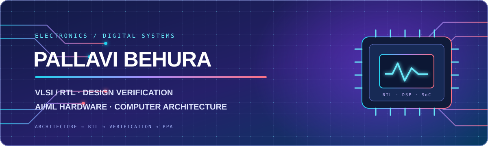

  
  
  

# Pallavi Behura

**Prefinal-Year B.Tech Electronics & Communication Engineering · VLSI / RTL · Design Verification · AI/ML Hardware**

I enjoy working at the boundary of **digital design, computer architecture and hardware acceleration**. My project work moves from architecture and RTL implementation to simulation, debugging, synthesis and implementation analysis.

My strongest current interests are **RTL design, SystemVerilog-based verification, RISC-V/SoC integration, DSP accelerators and AI/ML hardware**. I also explore RF/antenna engineering and embedded systems as part of my broader ECE work.

---

## Engineering focus

<table>
  <tr>
    <td width="50%" valign="top">
      <strong>01 · Digital design & RTL</strong> 
      Verilog/SystemVerilog, FSMs, datapaths, memory-mapped peripherals, register maps and IP integration.
    </td>
    <td width="50%" valign="top">
      <strong>02 · Design verification</strong> 
      Testbench architecture, transaction generation, drivers, monitors, scoreboards, assertions and waveform debugging.
    </td>
  </tr>
  <tr>
    <td width="50%" valign="top">
      <strong>03 · Computer architecture</strong> 
      RISC-V, processor/SoC integration, AMBA AXI4-Lite, APB, UART and hardware/software co-design.
    </td>
    <td width="50%" valign="top">
      <strong>04 · Hardware acceleration</strong> 
      FFT/IFFT, CORDIC, fixed-point datapaths, mixed precision, low-bit quantization and CNN datapath exploration.
    </td>
  </tr>
  <tr>
    <td width="50%" valign="top">
      <strong>05 · Implementation & PPA</strong> 
      FPGA synthesis, timing analysis, area evaluation, SAIF-based power estimation and design trade-off analysis.
    </td>
    <td width="50%" valign="top">
      <strong>06 · AI/ML hardware</strong> 
      PyTorch-based evaluation, Hessian-guided grouping, BFP2 quantization and hardware-aware optimization experiments.
    </td>
  </tr>
</table>

## Selected engineering projects

### 01 · Continuous-Flow 4096-Point FFT / IFFT Accelerator

**Verilog · DSP architecture · Clock gating · CORDIC · 45 nm synthesis analysis**

A continuous-flow, ROM-free FFT/IFFT architecture based on a conflict-free radix-16³ structure. The project explores occupancy-driven clock gating, reduced-cycle CORDIC computation and memory word-length optimization.

**Repository-documented evidence**
- 15/15 functional tests reported by the project.
- 19.08% area reduction against the reproduced baseline.
- 54.7% power-estimate reduction at 100% occupancy in the documented comparison.
- RTL variants, reference-model checks, simulation infrastructure and synthesis/power reports.

Power values are repository-reported pre-clock-tree estimates under the documented 45 nm flow.

[**Explore the FFT/IFFT repository →**](https://github.com/pallavibehurageek-cyber/Jointly-Optimized-Continuous-Flow-4096-Point-FFT-IFFT-Accelerator)

### 02 · RISC-V SoC with Custom ML Accelerator

**PicoRV32 · AXI4-Lite · APB · Q4.4 fixed point · Bare-metal firmware**

A processor-based SoC integrating a PicoRV32 RV32IM core, an AXI4-Lite-to-APB bridge, BRAM, a fixed-point matrix-multiplication accelerator, APB UART and memory-mapped control.

**Implementation details**
- 8 KB BRAM and a Q4.4 fixed-point 4×4 matrix datapath.
- Processor-to-peripheral communication through memory-mapped registers.
- Bare-metal firmware for exercising the integrated system.
- Repository-reported FPGA timing: 158 MHz Fmax and +3.67 ns WNS.

[**Explore the RISC-V SoC repository →**](https://github.com/pallavibehurageek-cyber/RISC-V-SoC-Custom-ML-Accelerator)

### 03 · AXI4-Lite Programmable PWM IP Core

**Verilog · AMBA AXI4-Lite · FSMs · Register interface · Self-checking simulation**

A synthesizable memory-mapped PWM peripheral with independent read and write control paths.

**Design features**
- AW, W, B, AR and R channel handling.
- WSTRB-aware register writes and programmable period/duty settings.
- Breathing mode, status flags and interrupt output.
- Self-checking testbench and waveform captures.

[**Explore the AXI4-Lite PWM repository →**](https://github.com/pallavibehurageek-cyber/AXI4-Lite-Programmable-PWM-Peripheral-IP-Core)

### 04 · APB RAM — SystemVerilog RTL Design & Verification

**SystemVerilog · AMBA APB · Testbench components · Scoreboard**

An APB RAM peripheral accompanied by a modular verification environment.

**Verification structure**
- Transaction-level stimulus and generator/driver separation.
- Monitor-based observation of interface activity.
- Expected-versus-observed checking through a scoreboard.
- Simulation logs and waveform artifacts for debugging.

The project is still undergoing functional debug and scoreboard refinement.

[**Explore the APB RAM repository →**](https://github.com/pallavibehurageek-cyber/SV-APB-RAM-RTL-Design-Verification)

### 05 · EvoFFT — Stage-Wise Mixed-Precision FFT Optimizer

**Python · Verilog · NSGA-II · FP4/FP8 · FPGA-oriented design exploration**

Explores stage-wise precision assignment for FFT hardware variants. A Python-driven search flow studies trade-offs between numerical fidelity and implementation costs such as LUT area, power and latency.

[**Explore the EvoFFT repository →**](https://github.com/pallavibehurageek-cyber/EvoFFT-StageWise-MixedPrecision-FFT-Optimizer)

## Active hardware experiments

<table>
  <tr>
    <td width="50%" valign="top">
      <strong><a href="https://github.com/pallavibehurageek-cyber/MaskCore-CNN-Accelerator">MaskCore — CNN Accelerator</a></strong> 
      SYSTEMVERILOG · ARITHMETIC MASKING · IN PROGRESS  
      Exploring arithmetic masking of weights, activations and partial sums in a CNN datapath. Current work centres on understanding the architecture, functional checks and implementation overhead. No physical side-channel resistance or tapeout result is claimed.
    </td>
    <td width="50%" valign="top">
      <strong><a href="https://github.com/pallavibehurageek-cyber/Hessian-Guided-BFP2-Quantization-Accelerator">Hessian-Guided BFP2 Quantization Accelerator</a></strong> 
      SYSTEMVERILOG · PYTORCH · 2-BIT BFP · IN PROGRESS  
      Exploring Hessian-guided weight grouping and a channel-scatter datapath for 2-bit block floating-point values. Full reference equivalence and hardware validation remain in progress.
    </td>
  </tr>
</table>

## Additional digital design

- [Weighted Round-Robin Arbiter](https://github.com/pallavibehurageek-cyber/Weighted-Round-Robin-Arbiter-Verilog) — credit-based arbitration and grant logic.
- [5-stage MIPS32 CPU](https://github.com/pallavibehurageek-cyber/RISC-MIPS32-CPU-Verilog) — pipelined processor implementation.
- [8-bit UART Communication System](https://github.com/pallavibehurageek-cyber/8-bit-RTL-UART-Communication-System) — transmitter/receiver RTL and loopback testbench.
- [128-Point Fixed-Point FFT Accelerator](https://github.com/pallavibehurageek-cyber/128-Point-Fixed-Point-FFT-Hardware-Accelerator) — RTL and testbench are present; simulation and numerical verification remain pending.

[**Browse all repositories →**](https://github.com/pallavibehurageek-cyber?tab=repositories)

---

## Technical toolkit

<strong>HDL, RTL & digital architecture</strong>

 

FSMs · RTL datapaths · fixed-point arithmetic · memory-mapped registers · bus interfaces · arbitration · processor/SoC integration · hardware/software co-design

<strong>Simulation, verification, synthesis & PPA</strong>

 

SystemVerilog testbenches · transaction generation · drivers · monitors · scoreboards · assertions · waveform debugging · synthesis · timing reports · area evaluation · SAIF-based power estimation · SQNR analysis

<strong>Programming, scientific computing & AI/ML</strong>

 

RISC-V Assembly · Matplotlib · Torchvision · Hugging Face Transformers · OpenCV · MediaPipe · Git · GitHub

<strong>RF, antennas & embedded systems — supporting ECE work</strong>

 
ANSYS HFSS · Altair FEKO · ESP32 · Arduino IDE · Vivaldi antennas · SIW antennas · S-parameters · VSWR · RIS phase mapping · embedded IoT

---

## Experience & technical programmes

| Experience / programme | Details |
|---|---|
| **DRDL — Design of Controller for Embedded System** | FPGA/VHDL controller work using Xilinx Spartan-3AN, hardware/software interlocks and RS-232 serial communication. |
| **NIELIT × SoCTeamup Semiconductors** | 30-hour bootcamp covering RTL, IP integration and SoC signoff under a MeitY-sponsored semiconductor EdTech initiative. |
| **IETE Hyderabad Centre** | One-month programme on Embedded IoT Application Development. |
| **Indo-Dutch Cyber Security School 2025** | 30 learning hours and 30 CPE credits; certificate of participation. |
| **NSI-45 Technical Poster** | Presented “Graphene MEMS RF Switches for UAV Radar Beam Steering” at Osmania University, January 2026. |
| **Jijnasa 2K25** | Paper-presentation recognition. |

## Engineering workflow

  <strong>UNDERSTAND THE ARCHITECTURE</strong> &nbsp; → &nbsp;
  <strong>WRITE RTL</strong> &nbsp; → &nbsp;
  <strong>VERIFY & DEBUG</strong> &nbsp; → &nbsp;
  <strong>SYNTHESIZE</strong> &nbsp; → &nbsp;
  <strong>ANALYZE PPA</strong>

I value reproducible simulation, clear assumptions, documented limitations and measured implementation trade-offs. Project status is stated openly so that results are not confused with work that is still under development.

---

[GitHub](https://github.com/pallavibehurageek-cyber) · [LinkedIn](https://www.linkedin.com/in/pallavi-behura-547329214/) · [Portfolio](https://pallavibehurageek-cyber.github.io/pallavi-portfolio/) · [Email](mailto:pallavibehurageek@gmail.com)

